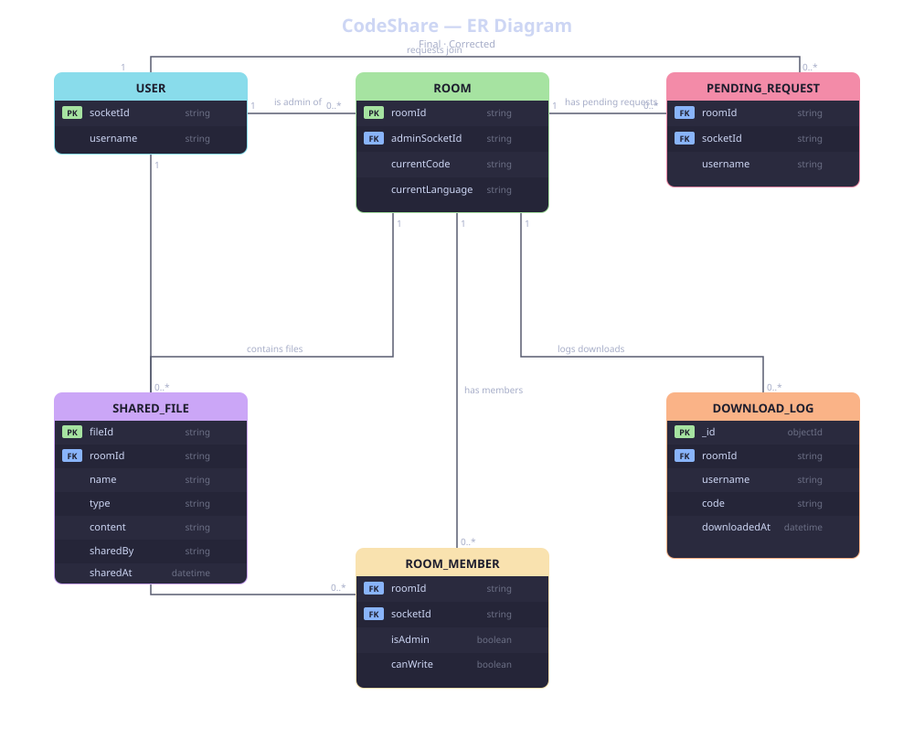

# CodeShare — Real-time Collaborative Code Editor



> Code likho, share karo, sath mein run karo — real-time mein.

CodeShare ek browser-based collaborative code editor hai jahan multiple users ek hi room mein ek saath code likh sakte hain. Admin-based permission system, file sharing, aur code execution sab built-in hai.

---

## Features

- **Real-time collaboration** — Socket.IO se sab users ka code instantly sync hota hai
- **Admin approval system** — Room join karne ke liye admin ki approval zaroori hai
- **Write permission control** — Admin kisi bhi user ko write access de ya le sakta hai
- **Kick user** — Admin kisi bhi user ko room se hata sakta hai
- **14 languages supported** — JavaScript, Python, Java, C++, C, C#, PHP, Ruby, Go, Rust, TypeScript, Swift, Plain Text
- **Boilerplate templates** — Har language ka apna starter template hai
- **Code execution** — Judge0 API ke through code run hota hai (stdin support ke saath)
- **File sharing** — Room ke andar files share kar sakte hain (max 5 MB)
- **Code download** — Current code `.js`, `.py`, `.java` etc. mein download kar sakte hain
- **Download logging** — MongoDB mein har download ka record save hota hai
- **Animated home page** — CSS particle background

---

## Tech Stack

| Layer | Technology |
|---|---|
| Frontend | React 19, React Router v7 |
| Editor | CodeMirror 5 (Dracula theme) |
| Real-time | Socket.IO v4 |
| Backend | Node.js, Express 5 |
| Database | MongoDB (download logs) |
| Code Execution | Judge0 CE (RapidAPI / public instance) |
| Notifications | react-hot-toast |
| Avatars | react-avatar |

---

## Project Structure

```
CodeShare/
├── public/
│   ├── index.html
│   ├── code-sync.png          # Logo
│   └── manifest.json
├── src/
│   ├── pages/
│   │   ├── Home.js            # Landing page — room create/join
│   │   └── EditorPage.js      # Main editor + sidebar
│   ├── components/
│   │   ├── Editor.js          # CodeMirror wrapper
│   │   ├── Client.js          # User card (kick / write toggle)
│   │   ├── OutputPanel.js     # stdout / stderr / stdin panel
│   │   └── FileSharePanel.js  # File upload & download panel
│   ├── Actions.js             # Socket event name constants
│   ├── LanguageTemplates.js   # Language list + boilerplate templates
│   ├── socket.js              # Socket.IO client init
│   ├── App.js                 # Routes
│   └── index.js
├── docs/
│   └── er-diagram.svg         # ER diagram
├── server.js                  # Express + Socket.IO server
├── runCode.js                 # Judge0 code execution wrapper
├── .env.example               # Environment variable template
└── package.json
```

---

## Setup & Installation

### Prerequisites

- Node.js v18+
- MongoDB (local ya Atlas)
- (Optional) RapidAPI key for Judge0 CE — bina key ke bhi public instance use hota hai

### 1. Clone karo

```bash
git clone https://github.com/deependra3647/Code-Share.git
cd Code-Share
```

### 2. Dependencies install karo

```bash
npm install
```

### 3. Environment variables set karo

`.env.example` ko copy karke `.env` banao:

```bash
cp .env.example .env
```

`.env` file:

```env
# MongoDB connection
MONGO_URI=mongodb://127.0.0.1:27017/codeshare
MONGO_DB_NAME=codeshare

# Express server port
PORT=5000

# Frontend dev server ke liye (local only)
REACT_APP_BACKEND_URL=http://localhost:5000

# (Optional) RapidAPI key for Judge0 — agar nahi hai to public instance use hoga
RAPIDAPI_KEY=your_rapidapi_key_here
```

---

## Running the App

### Development mode (frontend + backend alag)

Terminal 1 — Backend:
```bash
npm run server.dev
```

Terminal 2 — Frontend:
```bash
npm run start:front
```

Frontend: `http://localhost:3000`  
Backend: `http://localhost:5000`

### Production mode (single server)

```bash
npm start
```

Yeh pehle React build karega phir Express se serve karega — `http://localhost:5000`

---

## API Endpoints

| Method | Endpoint | Description |
|---|---|---|
| `GET` | `/api/rooms` | Active rooms ki list (roomId, user count, admin) |
| `POST` | `/api/downloads` | Download ka record MongoDB mein save karo |

---

## Socket Events

| Event | Direction | Description |
|---|---|---|
| `join` | Client → Server | Room join request |
| `joined` | Server → Client | Join confirm + current state |
| `join-request` | Server → Admin | Naya user approval maang raha hai |
| `approve-join` | Admin → Server | User ko approve karo |
| `reject-join` | Admin → Server | User ko reject karo |
| `join-approved` | Server → Client | Approval mili |
| `join-rejected` | Server → Client | Request reject hui |
| `code-change` | Client ↔ Server | Live code sync |
| `sync-code` | Client → Server | Naye user ko current code bhejo |
| `language-change` | Client ↔ Server | Language switch |
| `toggle-write` | Admin → Server | Write permission toggle |
| `permission-updated` | Server → Client | Permission badli notification |
| `permission-denied` | Server → Client | Permission nahi hai warning |
| `clients-updated` | Server → Client | Room members list refresh |
| `kick-user` | Admin → Server | User ko kick karo |
| `user-kicked` | Server → Client | Kicked user ko notify karo |
| `disconnected` | Server → Clients | User room se gaya |
| `file-share` | Client ↔ Server | File broadcast |

---

## Supported Languages

| Language | Extension | Execution |
|---|---|---|
| Plain Text | `.txt` | ❌ |
| JavaScript | `.js` | ✅ |
| TypeScript | `.ts` | ✅ |
| Python | `.py` | ✅ |
| Java | `.java` | ✅ |
| C++ | `.cpp` | ✅ |
| C | `.c` | ✅ |
| C# | `.cs` | ✅ |
| PHP | `.php` | ✅ |
| Ruby | `.rb` | ✅ |
| Go | `.go` | ✅ |
| Rust | `.rs` | ✅ |
| Swift | `.swift` | ✅ |
| File Share | — | — |

---

## How It Works

1. **Home page** pe user Room ID (auto-generate ya paste) aur username enter karta hai
2. Pehla user room ka **admin** ban jaata hai — usse seedha entry milti hai
3. Baad ke users **pending** state mein jaate hain, admin approve/reject karta hai
4. Approve hone ke baad user room mein aa jaata hai — current code aur language sync ho jaati hai
5. **Admin** write permission toggle kar sakta hai, kisi ko kick kar sakta hai
6. Language change karne par boilerplate template load hota hai (pehle wala code save rehta hai)
7. **File Share** mode select karne par editor hata ke file panel aata hai
8. **Run** button click karne par code Judge0 API ke through execute hota hai
9. **Download** button se code file save hoti hai aur MongoDB mein log hota hai

---

## ER Diagram


---

## Author

Built with 💛 by [Deependra](https://github.com/deependra3647/Code-Share)
